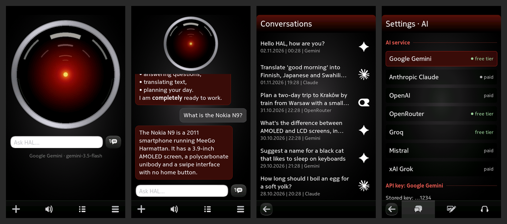

# HAL 2027 for the Nokia N9

*Opis po polsku poniżej.*

An AI assistant for the Nokia N9 (MeeGo Harmattan PR1.3), written in 2026, with a HAL-style
red eye. You talk to Gemini, Claude and other AI services using your own API key.
Designed and written by Claude (Anthropic) together with smyhu.



- **AI services:** Google Gemini, Anthropic Claude, OpenAI, OpenRouter, Groq, Mistral and
  xAI Grok, with model choice and thinking depth. Gemini, OpenRouter (`:free` models) and Groq
  can be used on a free tier; the others need a paid plan.
- **Gemini fallback:** when the chosen Gemini model is overloaded, HAL moves to the next model
  in the chain and says so in a banner.
- **Talking to HAL:** tap the microphone in the question field and speak; the eye follows your
  voice and a red arc in the ring counts the time (up to 30 s). Tap anywhere to finish. The
  speech is written into the field, you check it and press Enter. Speech to text goes through a
  chain of services (Gemini, then Groq Whisper, OpenAI, Mistral), skipping those without a key;
  the order is set in `services.json`.
- **The whole conversation on the main screen**, below the eye, in message bubbles. The question
  field grows with the text and sits halfway between the eye and the keyboard. Long press a
  bubble for Copy, Read aloud and Clear conversation.
- **Conversations:** every session is saved and listed like in a messenger, with date, time and
  the service's mark. Pull the list down at its top to search, the native MeeGo way: `*` stands
  for any text and `?` for one character; letter case and accents are ignored.
- **Reading aloud:** Google voice over Wi-Fi, or **offline** with eSpeak NG (speed and pitch
  adjustable). Auto mode picks one by itself. Auto-reading pauses when the battery is low;
  a mute button is on the toolbar.
- **Google Translate** with speech and a dictionary for single words.
- **Five eye colours**, the accent colour follows the eye.
- **Interface languages:** Polish and English, following the phone language. Texts are in
  `src/qml/strings.js`; add a column to translate the app.

## Install

Copy `dist/hal2027_0.1.13_armel.deb` to `/home/developer` on the phone (`/tmp` on the N9
has only 4 MB), then as root (developer mode):

```
aegis-dpkg -i /home/developer/hal2027_0.1.13_armel.deb
```

Requirements: Python 2.6, PySide and Qt Components, all present on a standard PR1.3 phone.
The AI services use HTTPS with TLS 1.2, so the phone needs a TLS 1.2 capable QtNetwork
(the community TLS patch).

## API keys

Type the key in Settings, or put a text file `hal2027-keys.txt` in MyDocs (the folder Windows
shows when the phone is connected over USB), one line per service:

```
gemini=YOUR_KEY
claude=YOUR_KEY
openrouter=YOUR_KEY
```

Service names: `gemini`, `claude`, `openai`, `openrouter`, `groq`, `mistral`, `xai`.
Then tap Settings → Import keys from a file. HAL stores the keys and deletes the file.
Keys stay on the phone only.

## Changing services without a new package

Servers, models and headers are in `/opt/hal2027/services.json`. To change them, put
`hal2027-services.json` in MyDocs with only the fields you change,
matched by `id`. New services of kind `gemini`, `anthropic` or `openai` (OpenAI-compatible)
can be added the same way. An example is in `packaging/doc/hal2027-services.example.json`.

## Layout

| Part | What it does |
|---|---|
| `src/main.py` | PySide launcher: chat requests, history, keys, speech, settings |
| `src/services.json` | the list of AI services (servers, models, headers) |
| `src/qml/` | UI (Harmattan Qt Components), translations (`strings.js`), service marks |
| `helper/` | `hal2027-fetch`, a small C++/Qt program that does all HTTP(S) requests, and `hal2027-rec`, a small C program that records speech through PulseAudio; their sources and cross-build scripts |
| `espeak/` | eSpeak NG 1.52.0 built for the N9, its data and the cross-build script |
| `packaging/` | Debian control file, launcher entry, copyright, docs |
| `tools/` | Python scripts that drew the eye, its colours, the icon and the service marks |

`./build-deb.sh` builds the package into `dist/`.

The network work is done in a separate process on purpose: QtNetwork inside Python crashes on
the N9 when the TLS patch is installed (Python carries the old OpenSSL 0.9.8, the patch makes
Qt load OpenSSL 1.0.x).

## Licences and marks

- HAL 2027: MIT (`LICENSE`).
- eSpeak NG (`espeak/`): GNU GPL version 3 or later (`packaging/doc/espeak-ng/COPYING`),
  shipped unmodified as a separate program. Built from the Debian source
  [espeak-ng_1.52.0+dfsg](https://deb.debian.org/debian/pool/main/e/espeak-ng/espeak-ng_1.52.0+dfsg.orig.tar.gz)
  with `espeak/build-espeak-arm.sh`; the ru, cmn and yue dictionaries are left out.
- Service marks in the conversation list come from
  [LobeHub Icons](https://github.com/lobehub/lobe-icons) (MIT), recoloured white. They are
  trademarks of their owners (Google, Anthropic, OpenAI, OpenRouter, Groq, Mistral AI, xAI)
  and are used only to show which service a conversation was held with. This project is not
  affiliated with any of them.
- AI answers come from the service you choose, under that service's terms. Google Translate
  and Google speech are used through their public endpoints.
- The translator language list comes from [MeeTranslate](https://github.com/smyhu/meetranslate-n9) (MIT).

## Credits

Designed and written by Claude (Anthropic) together with smyhu for the Nokia N9.

---

## Po polsku

Asystent AI dla Nokii N9 (MeeGo Harmattan PR1.3), napisany w 2026 r., z czerwonym okiem
w stylu HAL-a. Rozmawiasz z Gemini, Claude i innymi usługami AI, używając własnego klucza API.
Zaprojektowany i napisany przez Claude (Anthropic) wspólnie ze smyhu dla Nokii N9.

- **Usługi AI:** Google Gemini, Anthropic Claude, OpenAI, OpenRouter, Groq, Mistral, xAI Grok.
  Darmowo: Gemini, OpenRouter (modele `:free`) i Groq; pozostałe wymagają płatnego planu.
- **Mówienie do HAL-a:** dotknij mikrofonu w polu pytania i mów; dotknięcie ekranu kończy.
  Tekst trafia do pola, sprawdzasz i wciskasz Enter. Rozpoznawanie łańcuchem usług (Gemini,
  Groq, OpenAI, Mistral).
- **Cała rozmowa na ekranie głównym** pod okiem; przytrzymanie dymka: Kopiuj, Czytaj na głos,
  Wyczyść rozmowę.
- **Rozmowy:** lista wszystkich sesji jak w komunikatorze, z datą, godziną i znakiem usługi;
  pociągnięcie listy w dół otwiera wyszukiwanie (`*` i `?`).
- **Czytanie na głos:** głos Google przez Wi-Fi albo offline (eSpeak NG), z tempem i wysokością.
- **Tłumacz Google**, pięć kolorów oka, interfejs po polsku i angielsku.

Instalacja: skopiuj `dist/hal2027_0.1.13_armel.deb` do `/home/developer` w telefonie i jako
root (tryb dewelopera) uruchom `aegis-dpkg -i /home/developer/hal2027_0.1.13_armel.deb`.

Klucze: wpisz w Ustawieniach albo zapisz plik `hal2027-keys.txt` w MyDocs (linie
`gemini=KLUCZ`) i dotknij Ustawienia → Wczytaj klucze z pliku; HAL zapisze klucze i usunie plik.
